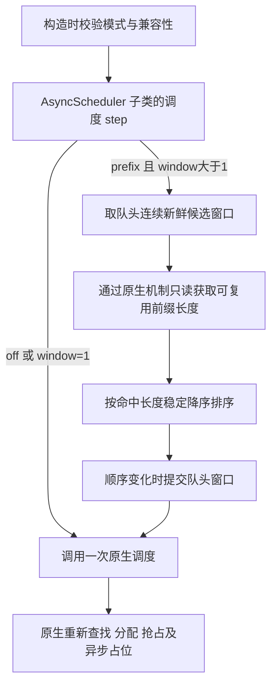

# 调度接入与实现边界

## 当前结构

`src/vllm_prefix_scheduler/` 包含证据检查、M1 host-side 原生重放 `native_replay.py`，以及 M2A 的 `config.py`、`probe.py`、`scheduler.py`。M1 保留直接构造原生类和测试控制组一次 B/C 改序的既有机制，见 [M1 记录](research/m1-native-bc-replay.md)。M2A 的 `PrefixAsyncScheduler` 直接继承固定版本 `AsyncScheduler`，经原生 `get_scheduler_cls()` 解析和构造；独立原生工厂与验证矩阵位于 `tests/native/m2a_*`，不放宽 M1 工厂或门槛。见 [M2A 设计](research/m2a-prefix-scheduler.md)与[交接](research/m2a-handoff.md)。

`scripts/validate_model.py` 使用原生 LLM，`scripts/diagnostic_worker.py` 通过具名 worker RPC 读取模型精度、调度配置和 KV 分配。诊断扩展不修改调度顺序或模型执行，也不需要开启不安全的函数序列化。

实测运行使用 V2 GPU Model Runner、FlashAttention 2 和单 full-attention group。eager 模式关闭 torch.compile、CUDA Graph 和 JIT warmup；APC 与异步调度在 worker 中保持开启。

## 原生调用链

锁定版本中的关键位置：

| 文件 | 需要理解的职责 |
|---|---|
| `vllm/config/scheduler.py` | `scheduler_cls` 解析及 `AsyncScheduler` 选择 |
| `vllm/v1/engine/core.py` | 初始化缓存、实例化 scheduler、推进调度与执行 |
| `vllm/v1/core/sched/async_scheduler.py` | 异步占位和调度派生行为 |
| `vllm/v1/core/sched/scheduler.py` | 原生等待队列、准入、分配、抢占和恢复 |
| `vllm/v1/core/kv_cache_manager.py` | 前缀命中查找及分配入口 |
| `vllm/v1/core/single_type_kv_cache_manager.py` | 单类型缓存查找细节与块对齐 |
| `vllm/v1/core/block_pool.py` | 引用计数、free queue、hash 映射与淘汰 |
| `vllm/v1/kv_cache_interface.py` | 原生 KV 结构；当前分配字段为 `kv_cache_tensors` |

固定来源哈希在 `configs/native-m2a.json`。评分路径已逐行检查，并在真实对象、full KV events、统计和 metrics 同时开启时验证；升级上游后需要重新调查及验证，不能沿用本次结论。

## M2A 调度流程

`guarded` 在配置解析时明确报未实现。扩展不参与原生输出更新、释放或模型执行；原生 running 阶段可能改变评分时的缓存，后续原生重新查找和分配仍具有最终决定权。合成 runner 回归未运行模型或 KV tensor 计算。

## 配置与回退

通过完整类名 `vllm_prefix_scheduler.scheduler.PrefixAsyncScheduler` 和 `additional_config["prefix_scheduler"]` 接入，默认 `mode=off`、`window=16`、`max_wait_ms=500`。严格拒绝未知键、非法类型和范围，数值不接受 bool。prefix 启动时验证单 CUDA GPU 语义、所有并行维度为1、原生异步/V2、单因果 full-attention group、FCFS、APC、普通文本生成及块大小一致；分布式、offload、连接器、投机、LoRA、多模态等不兼容配置明确拒绝。

off 直接调用原生 schedule，不访问窗口、评分或等待时钟，支持 APC 关闭。prefix/window=1 先完成兼容性校验，再直接走原生路径。全冷及同分保持窗口当前 FIFO。不静默更换调度模式。运行中的非候选请求和边界请求继续由原生路径处理。

## 排序与状态

候选必须是队头连续的新鲜 `WAITING` 请求。不能跨过 blocked、恢复或部分计算请求；不能扫描整个队列后取前 N 项。记录排序成本时区分取窗口、缓存评分和恢复队列。

`prefix` 每步重新读取缓存，不保存跨步分数或请求级元数据。只读路径为 `prefix_cache_lookup_enabled(request)` 后调用 coordinator 的 `find_longest_cache_hit(request.block_hashes, request.num_tokens - 1)`，只返回命中长度。不能使用会在 full 报告模式发事件的 `get_computed_blocks` 评分，也不临时关闭事件。

先完成评分和排序，再只替换顺序改变的队头窗口；`prepend_requests` 的 extendleft 语义要求传入反序。super 前提交异常通过真实 deque 原语恢复；已进入原生 schedule 后不回滚。M2B 才考虑 monotonic 等待保护及其元数据生命周期，当前 `max_wait_ms` 不产生保护功能。

真实 chunk 保持 running 优先级；抢占即使进度归零也由抢占历史、in-flight/stale 等字段排除。窗口不修改 `running`、`kv_holding_waiting` 或 `deferred_waiting`。原生自身跳过 blocked 请求与插件跨屏障重排分别判定。取消时保留的历史对象字段不等同于活跃引用泄漏；ID 复用仅在旧代 pending 排空后验证。测试 generation ledger 不进入生产类。

## 验证层次

本地记录检查只验证归档数据的内部一致性。真实 Scheduler replay 验证机制与排序语义；原生回归验证生命周期与副作用；GPU 集成验证异步实际运行与资源；配对实验才支持性能和公平性结论。每层的结果都需标明，不能互相替代。
