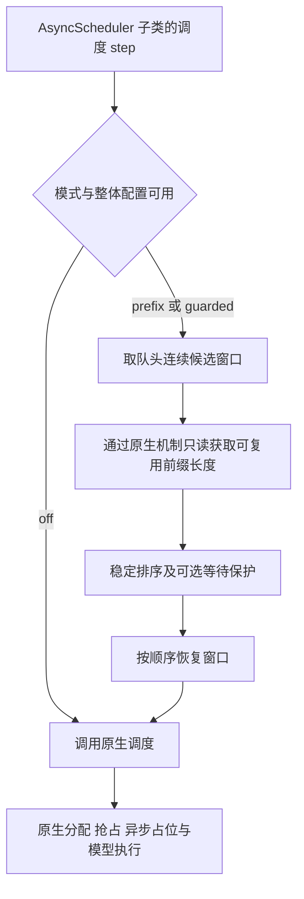

# 调度接入与实现边界

## 当前结构

`src/vllm_prefix_scheduler/` 是项目包，目前只包含公开证据的一致性检查。`scripts/validate_model.py` 使用原生 LLM，`scripts/diagnostic_worker.py` 通过具名 worker RPC 读取模型精度、调度配置和 KV 分配。诊断扩展不修改调度顺序或模型执行，也不需要开启不安全的函数序列化。

实测运行使用 V2 GPU Model Runner、FlashAttention 2 和单 full-attention group。eager 模式关闭 torch.compile、CUDA Graph 和 JIT warmup；APC 与异步调度在 worker 中保持开启。

## 原生调用链

锁定版本中的关键位置：

| 文件 | 需要理解的职责 |
|---|---|
| `vllm/config/scheduler.py` | `scheduler_cls` 解析及 `AsyncScheduler` 选择 |
| `vllm/v1/engine/core.py` | 初始化缓存、实例化 scheduler、推进调度与执行 |
| `vllm/v1/core/sched/async_scheduler.py` | 异步占位和调度派生行为 |
| `vllm/v1/core/sched/scheduler.py` | 原生等待队列、准入、分配、抢占和恢复 |
| `vllm/v1/core/kv_cache_manager.py` | 前缀命中查找及分配入口 |
| `vllm/v1/core/single_type_kv_cache_manager.py` | 单类型缓存查找细节与块对齐 |
| `vllm/v1/core/block_pool.py` | 引用计数、free queue、hash 映射与淘汰 |
| `vllm/v1/kv_cache_interface.py` | 原生 KV 结构；当前分配字段为 `kv_cache_tensors` |

不要仅依据文档中的方法名推断副作用，评分接入前需要逐行检查原生实现，并用真实对象快照验证。

## 待实现的调度流程

图表示计划接口，当前仓库尚无自定义 scheduler class。实现时以 native replay 作为准入条件，再在项目包中增加适配器；不在 readiness 脚本中夹带调度逻辑。

## 配置与回退

通过 `additional_config["prefix_scheduler"]` 配置 `mode`、`window` 和 `max_wait_ms`。不增加公共 HTTP 参数。启动时验证单 GPU、单 full-attention group、FCFS、APC 及支持的请求类型；不兼容的整体配置拒绝启用优化。

APC 关闭、窗口为 1 或全冷负载的具体行为要用原生测试明确。无效配置不得悄悄改为另一种优化。运行中的非候选请求和边界请求继续由原生路径处理。

## 排序与状态

候选必须是队头连续的新鲜 `WAITING` 请求。不能跨过 blocked、恢复或部分计算请求；不能扫描整个队列后取前 N 项。记录排序成本时区分取窗口、缓存评分和恢复队列。

`prefix` 使用稳定排序；`guarded` 先按原始到达顺序排列达到阈值的候选，再排序未保护的候选。保护时间使用单调时钟，维护明确的入队、重新排队和终止规则。不要直接混用 wall-clock 到达时间和 monotonic 时间。

完成、取消、抢占、恢复和 ID 复用都需要检查元数据生命周期。批量 prepend 后要逐项核对实际 deque 顺序。只读评分不能改变引用计数、hash 映射、free queue、统计或事件流。

## 验证层次

本地记录检查只验证归档数据的内部一致性。真实 Scheduler replay 验证机制与排序语义；原生回归验证生命周期与副作用；GPU 集成验证异步实际运行与资源；配对实验才支持性能和公平性结论。每层的结果都需标明，不能互相替代。
